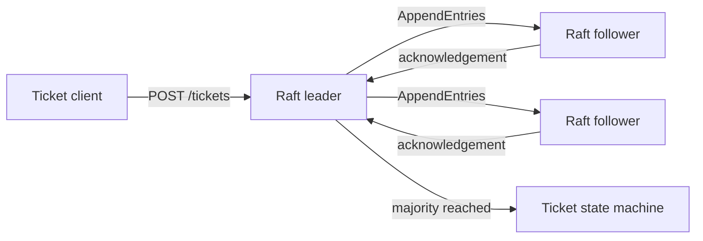

# Raft Ticketing System

[](https://github.com/xlong2/CS647/actions/workflows/ci.yml)

A Java 17 implementation of the core Raft consensus rules, applied to a replicated
ticket-inventory service. The project demonstrates leader election, log replication,
majority commit, state-machine execution, failover, HTTP-based cluster communication,
and container orchestration.

This is a portfolio project, not a production consensus library. Its deliberately small
scope makes the safety rules visible in code and deterministic in tests.

## What it demonstrates

- One vote per server per term and candidate log-freshness checks.
- Candidate, follower, and leader state transitions.
- AppendEntries consistency checks and conflicting-suffix replacement.
- Majority acknowledgement before applying a ticket purchase.
- Exactly-once application of committed entries on each node.
- Protection against negative inventory, including pending uncommitted purchases.
- Leader failover and reconciliation of a stale former leader.
- A deterministic core separated from timers, HTTP, and process lifecycle concerns.
- Three-node Docker Compose and Kubernetes StatefulSet deployments.
- A small tested Lamport clock retained from the project's coursework origins.

## Architecture



The protocol state in `RaftNode` has no sockets, sleeps, or background threads.
`RaftClusterService` supplies randomized election timers and quorum coordination, while
`HttpClusterTransport` and `TicketingHttpServer` provide process-to-process communication.
See [architecture.md](docs/architecture.md) for the full request and failure flows.

## Quick start

Prerequisite: JDK 17 or newer. The Maven wrapper downloads Maven automatically.

```bash
sh ./mvnw verify
```

The build runs the tests, generates a JaCoCo report in `target/site/jacoco`, and creates
`target/raft-ticketing.jar`.

### Run a single node

```bash
NODE_ID=node-0 \
PEERS=node-0=http://localhost:8080 \
java -jar target/raft-ticketing.jar
```

After the node elects itself leader:

```bash
curl http://localhost:8080/status

curl -X POST http://localhost:8080/tickets \
  -H 'Content-Type: application/json' \
  -d '{"tickets":5}'
```

### Run a three-node cluster

```bash
docker compose up --build -d
sh scripts/demo.sh
docker compose down
```

The nodes are exposed on ports `8080`, `8081`, and `8082`. The demo waits for a leader,
commits a purchase, and prints every node's status.

## HTTP API

| Method | Path | Purpose |
|---|---|---|
| `GET` | `/health` | Container health check |
| `GET` | `/status` | Role, term, log, commit, and inventory state |
| `POST` | `/tickets` | Purchase tickets through the leader |
| `POST` | `/raft/vote` | Internal RequestVote RPC |
| `POST` | `/raft/append` | Internal AppendEntries RPC |

A follower answers a purchase with HTTP `409` and includes its last known leader. A
quorum failure returns HTTP `503`; as in real consensus systems, that outcome is
ambiguous because the entry could commit after the client times out.

## Configuration

| Environment variable | Default | Example |
|---|---|---|
| `NODE_ID` | `node-0` | `node-1` |
| `PORT` | `8080` | `8081` |
| `INITIAL_TICKETS` | `100` | `500` |
| `PEERS` | local single node | `node-0=http://node-0:8080,node-1=http://node-1:8080` |

Every node must use the same member list and initial inventory.

## Repository guide

```text
src/main/java/.../core/       deterministic Raft and ticket state machine
src/main/java/.../cluster/    timers, quorum coordination, HTTP transport
src/main/java/.../http/       public and internal HTTP endpoints
src/main/java/.../clock/      Lamport logical clock example
src/test/                     deterministic protocol and invariant tests
deploy/kubernetes/            three-node StatefulSet and headless Service
docs/                         architecture, decisions, and project evolution
```

## Engineering decisions and limitations

The implementation sends the full leader log on replication instead of maintaining a
`nextIndex` for every follower. This is valid for the demonstrated conflict rules but is
inefficient for large logs. State is in memory; restart persistence, snapshots, dynamic
membership, pre-vote, transport security, and idempotent client request IDs are outside
the current scope. These tradeoffs are discussed in [design-decisions.md](docs/design-decisions.md).

## Project origin

This repository began as CS647 distributed-systems coursework in 2019: Lamport clocks,
an Akka finite-state-machine Raft prototype, a replicated ticketing exercise, and an
early Kubernetes deployment. In 2026 it was rebuilt as this focused portfolio project:
generated artifacts and third-party papers were removed, the consensus core was
separated from infrastructure, deterministic tests were added, and the deployment was
consolidated. See [project-evolution.md](docs/project-evolution.md).

The active implementation is original to this refactor and is available under the MIT
License. Historical commits may retain their original third-party notices.
