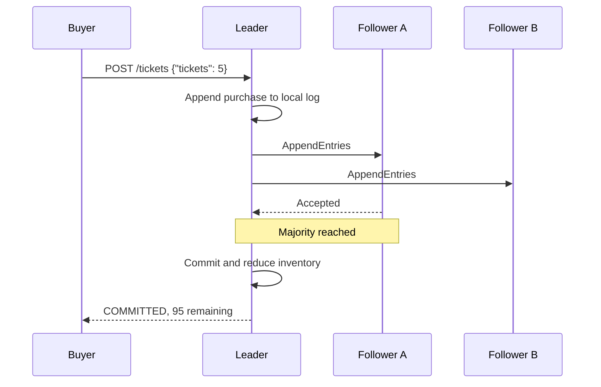
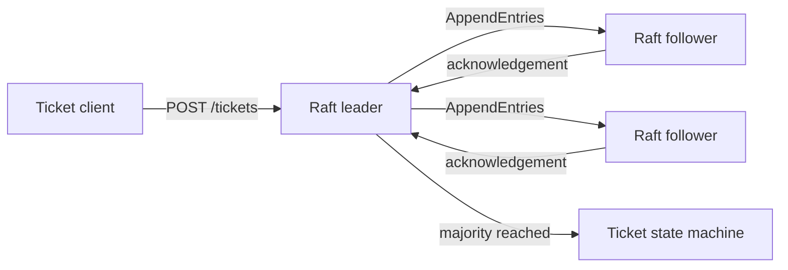

# Raft Ticketing System

[](https://github.com/xlong2/CS647/actions/workflows/ci.yml)

## The problem: three servers, one ticket count

Imagine that a venue has 100 tickets left. Its inventory service runs on three servers
so that one machine can fail without taking sales offline. A buyer asks one server for
the last five tickets at the same moment another buyer reaches a different server.

Each server has its own copy of the inventory. If they update those copies independently,
they can approve more tickets than the venue owns. If they wait for every server, one
failed machine can stop all sales. The servers need a way to agree on one ordering of
purchases while still making progress when a minority of the cluster is unavailable.

This project uses the **Raft consensus algorithm** to make that agreement. The servers
elect one leader, record each purchase in a replicated log, and apply the purchase to
the ticket inventory only after a majority has accepted it. If the leader fails, the
remaining majority elects a replacement and continues from the committed log.

The result is a compact Java service that makes distributed-systems behavior visible:
you can start three processes, submit a purchase, stop the leader, and watch the cluster
recover without overselling its inventory.

> This is an educational portfolio project, not a production consensus library. Its
> deliberately small scope keeps the safety rules readable and deterministic in tests.

## From CS647 lessons to a working service

The project grew out of four CS647 assignments. Each assignment answered a question
raised by the one before it and became a layer of the final system.

### Chapter 1 — How do distributed processes reason about order?

The first assignment implemented a **Lamport logical clock**. It showed that machines
cannot rely on perfectly synchronized wall clocks to decide which distributed event
happened first. Processes instead exchange logical timestamps that preserve causal
ordering.

The final repository retains this idea in `LogicalClock`, with tests for local events,
message sends, and message receipt. Raft does not use Lamport timestamps directly, but
the exercise established the central problem behind the project: independent machines
must construct a shared notion of order through messages.

### Chapter 2 — How do the servers agree on one history?

The second assignment explored **Raft** with Akka finite-state-machine actors. It
introduced followers, candidates, leaders, election terms, voting, heartbeats, and log
replication.

Those protocol rules now live in the deterministic `RaftNode` core. A node grants at
most one vote per term, rejects candidates with stale logs, checks the previous entry
before appending new ones, and replaces conflicting uncommitted suffixes. Network I/O
and timers sit outside the core, so the agreement rules can be tested without sleeps or
race-prone actor timing.

### Chapter 3 — What useful work should the agreed log perform?

The third assignment connected consensus to a **movie-ticket state machine**. A log is
only a history; applying its committed commands turns agreement into a service.

In this version, a purchase first becomes a Raft log entry. The leader sends the entry
to its followers and waits for majority acknowledgement. Only then is it committed and
applied to `TicketStateMachine`. The state machine rejects invalid purchases, committed
entries are applied once, and both committed and pending purchases are considered so
inventory cannot fall below zero.

### Chapter 4 — How does the cluster run outside the classroom?

The fourth assignment introduced containers and **Kubernetes deployment**. The
portfolio version carries that work forward with an HTTP transport, health and status
endpoints, a three-node Docker Compose environment, and a Kubernetes StatefulSet with
stable node identities.

The 2026 portfolio rebuild then joined the four lessons into one maintainable project.
It replaced duplicated assignment snapshots and generated files with a Maven build,
clear component boundaries, deterministic JUnit tests, CI, container packaging, and
focused documentation. [Project evolution](docs/project-evolution.md) maps the original
coursework evidence to the current implementation in more detail.

## Verifiable 2019 foundation

The portfolio implementation is new, but the ideas behind it are not retroactively
dated. Git commit
[`56f8f12`](https://github.com/xlong2/CS647/commit/56f8f1254a71e73ddd5e35edd3818fbc2662399a),
authored on July 5, 2019, preserves the original coursework source. A later
[`1dc1f53`](https://github.com/xlong2/CS647/commit/1dc1f5386c7a14818783ed37407a0fb984959f9e) revision from August 25,
2019 includes the Kubernetes coursework updates.

These historical files show the path from the first experiments to the current design:

| Original coursework evidence | What it explored | Portfolio evolution |
|---|---|---|
| [`LamportClock.java`](https://github.com/xlong2/CS647/blob/56f8f1254a71e73ddd5e35edd3818fbc2662399a/hw1/lamport-akka/src/main/java/com/example/LamportClock.java) and [`ResourceActor.java`](https://github.com/xlong2/CS647/blob/56f8f1254a71e73ddd5e35edd3818fbc2662399a/hw1/lamport-akka/src/main/java/com/example/ResourceActor.java) | Logical time and ordering distributed resource requests | Small, thread-safe `LogicalClock` with focused tests |
| [`NodeOnFsm.java`](https://github.com/xlong2/CS647/blob/56f8f1254a71e73ddd5e35edd3818fbc2662399a/hw2/cs647%20HW2%20%20Xiyao%20Long/src/main/java/sample/fsm/NodeOnFsm.java) | Raft roles and transitions expressed as an Akka finite-state machine | Framework-independent `RaftNode` with deterministic protocol tests |
| [`StateMachine.java`](https://github.com/xlong2/CS647/blob/56f8f1254a71e73ddd5e35edd3818fbc2662399a/hw3/cs647%20HW3%20%20Xiyao%20Long/src/main/java/sample/fsm/StateMachine.java) | Applying replicated commands to ticket inventory | `TicketStateMachine` with overselling and exactly-once invariants |
| [`akka-workers.yaml`](https://github.com/xlong2/CS647/blob/1dc1f5386c7a14818783ed37407a0fb984959f9e/hw4/kubernetes/akka-workers.yaml) | Running distributed actors as Kubernetes workers | One documented three-replica StatefulSet with stable identities and health probes |

The original files remain in Git history instead of the active source tree, keeping the
project build focused while preserving a directly inspectable record of its 2019
foundation.

## What happens when someone buys tickets?



1. A buyer sends a purchase to the leader.
2. The leader validates that the request cannot oversell available inventory and appends
   it to its local log.
3. The leader replicates its log to the followers.
4. After a majority acknowledges the entry, the leader commits it and applies it to the
   ticket state machine.
5. Subsequent heartbeats communicate the commit index, so followers apply the same
   purchase in the same position.

If a buyer contacts a follower, it returns HTTP `409` with the last known leader. If the
cluster loses its majority, it returns HTTP `503` rather than claiming an unsafe commit.

## What happens when the leader fails?

Followers expect regular heartbeats. When they stop arriving, a follower increments
the term, becomes a candidate, and asks the other servers for votes. A candidate can
become leader only after winning a majority, and voters reject a candidate whose log is
less up to date than their own. These rules prevent two isolated minorities from safely
committing different purchases.

Once elected, the new leader resumes replication from the cluster's agreed history. A
stale former leader that returns observes the newer term, steps down, and reconciles its
uncommitted log with the current leader.

## Architecture



The implementation separates protocol decisions from infrastructure:

- `RaftNode` owns terms, roles, votes, the replicated log, and commit/application rules.
- `RaftClusterService` owns randomized election timers, heartbeats, and quorum
  coordination.
- `HttpClusterTransport` carries Raft messages between processes.
- `TicketingHttpServer` exposes client and internal cluster endpoints.
- `TicketStateMachine` turns committed purchase commands into remaining inventory.

See [architecture.md](docs/architecture.md) for the component, election, purchase, and
failure flows.

## Try the story yourself

Prerequisite: JDK 17 or newer. The Maven wrapper downloads Maven automatically.

First, build the application and run its tests:

```bash
sh ./mvnw verify
```

The build creates `target/raft-ticketing.jar` and a JaCoCo coverage report in
`target/site/jacoco`.

### Run a single node

```bash
NODE_ID=node-0 \
PEERS=node-0=http://localhost:8080 \
java -jar target/raft-ticketing.jar
```

After the node elects itself leader, inspect it and buy five tickets:

```bash
curl http://localhost:8080/status

curl -X POST http://localhost:8080/tickets \
  -H 'Content-Type: application/json' \
  -d '{"tickets":5}'
```

### Run the three-node demonstration

```bash
docker compose up --build -d
sh scripts/demo.sh
docker compose down
```

The nodes are exposed on ports `8080`, `8081`, and `8082`. The demonstration waits for
a leader, commits a purchase, and prints every node's status so you can see the same
inventory replicated across the cluster.

## HTTP API

| Method | Path | Purpose |
|---|---|---|
| `GET` | `/health` | Check process health |
| `GET` | `/status` | Inspect role, term, log, commit, and inventory state |
| `POST` | `/tickets` | Purchase tickets through the leader |
| `POST` | `/raft/vote` | Exchange internal RequestVote messages |
| `POST` | `/raft/append` | Exchange internal AppendEntries messages |

A follower answers a purchase with HTTP `409` and its last known leader. A quorum
failure returns HTTP `503`; as in real consensus systems, that result is ambiguous
because the entry could commit after the client times out.

## Configuration

| Environment variable | Default | Example |
|---|---|---|
| `NODE_ID` | `node-0` | `node-1` |
| `PORT` | `8080` | `8081` |
| `INITIAL_TICKETS` | `100` | `500` |
| `PEERS` | local single node | `node-0=http://node-0:8080,node-1=http://node-1:8080` |

Every node must use the same member list and initial inventory.

## Repository guide

```text
src/main/java/.../core/       deterministic Raft and ticket state machine
src/main/java/.../cluster/    timers, quorum coordination, HTTP transport
src/main/java/.../http/       public and internal HTTP endpoints
src/main/java/.../clock/      Lamport logical clock exercise
src/test/                     protocol, failover, API, and invariant tests
deploy/kubernetes/            three-node StatefulSet and headless Service
docs/                         architecture, decisions, and project evolution
```

## Engineering decisions and limits

For readability, the leader sends its full log during replication instead of tracking a
`nextIndex` for every follower. That approach demonstrates Raft's consistency and
conflict rules but is inefficient for large histories. State is held in memory, so a
process restart does not yet recover its term, vote, log, or ticket count from disk.

Snapshots, dynamic membership, pre-vote, transport security, and idempotent client
request IDs are also outside the current scope. These limits are explicit future
engineering work rather than production-readiness claims. See
[design decisions](docs/design-decisions.md) for the reasoning and tradeoffs.

## License and attribution

The active implementation was created for this portfolio rebuild and is available under
the MIT License. The repository began as CS647 distributed-systems coursework in 2019;
historical commits may retain their original third-party notices.
