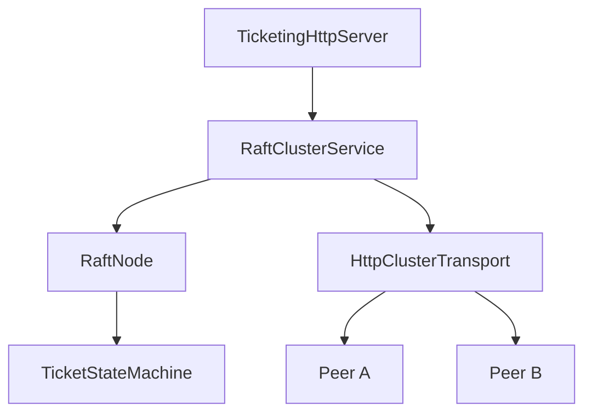

# Architecture

## Component boundaries

`RaftNode` owns protocol state: current term, vote, role, log, commit index, last-applied
index, and the replicated ticket state machine. Every public operation is synchronized,
and it contains no nondeterministic timing or I/O.

`RaftClusterService` owns the operational behavior: randomized election timeouts,
heartbeats, peer RPC dispatch, quorum counting, and client-write coordination.

`TicketingHttpServer` exposes status and purchase endpoints and accepts the two internal
Raft RPCs. `HttpClusterTransport` performs those RPCs asynchronously with Java's HTTP
client and Jackson JSON serialization.

## Election flow

1. A follower's randomized election timeout expires.
2. It increments its term, votes for itself, and becomes a candidate.
3. It sends RequestVote with its last log index and term.
4. A follower grants at most one vote in that term and only when the candidate's log is
   at least as current as its own.
5. A candidate that receives a majority becomes leader and starts periodic heartbeats.
6. Any response or AppendEntries request with a newer term makes the node step down.

## Purchase flow

1. The HTTP request must reach the leader.
2. The leader checks committed inventory minus all pending log reservations.
3. It appends a purchase command to its current-term log.
4. It sends AppendEntries to both followers.
5. A majority acknowledgement advances the commit index.
6. The leader applies the command and sends the updated commit index in its next
   heartbeat, causing followers to apply the same entry.

No node applies an uncommitted purchase. Replaying a heartbeat does not apply an entry
twice because `lastApplied` advances monotonically.

## Failure behavior

If the leader becomes unavailable, a follower eventually starts a higher-term election.
A voter rejects a candidate that is missing a log entry the voter already has. When the
old leader returns and receives a higher-term AppendEntries request, it becomes a
follower and reconciles its uncommitted suffix.

If a client does not receive a quorum, the service reports `NO_QUORUM`. The local entry
is intentionally retained because it may be replicated and committed later. Production
clients would attach a stable request ID so retries could be deduplicated.
